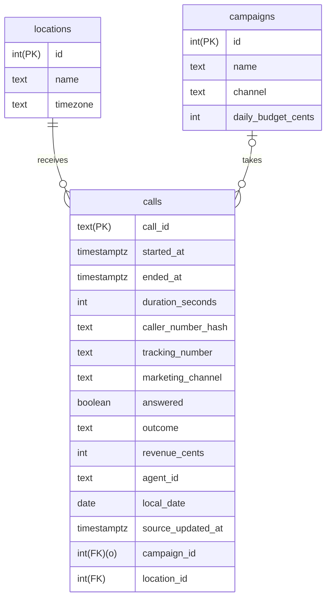

# Decisions

The main design choices behind this dashboard, the alternatives we considered, and what each choice costs us. The question it answers: *which campaigns turn calls into revenue, and at what cost?*

Each decision has a plain-English summary, then a short technical note. Full detail is in [plans/PLAN.md](plans/PLAN.md) (section 4 for decisions, section 7 for metric definitions). PLAN.md uses its own D1-D12 numbering, which differs from the numbers here.

## Tech stack

### 1. Separate Rails API and Next.js frontend

A Ruby on Rails API (JSON only) serves the numbers; a Next.js + TypeScript app renders them. The two share nothing but the API's address, so each can be built, tested, released and scaled on its own.

- **Why:** a clear boundary between data and display. Rails is strong at the database work and import; Next.js gives a modern UI with server rendering. A future chatbot or other client can call the same API.
- **Alternative: Rails full-stack (Hotwire/ERB).** One app and less to run, but a weaker fit for interactive charts and typed UI code, and the UI could not be released separately from the data.
- **Alternative: Next.js only (route handlers + an ORM).** One language, but we would write the import and SQL aggregation without Rails' migrations and testing conventions.
- **Cost:** two apps to build and test instead of one, and a network hop between them.

### 2. PostgreSQL as the only data store

- **Why:** the data is small (about 5,000 calls), relational, and needs date math, timezones and constraints that Postgres handles natively. It is also available as a managed service on every major cloud.
- **Alternative: SQLite.** Simpler to ship, but weaker timezone support, and a file on one machine does not suit an API that may run on several instances.
- **Alternative: an analytics store (ClickHouse, BigQuery).** Built for scale we do not have; far too heavy for this size.

### 3. Docker Compose for local development and review

Compose runs the database, API and UI with one command.

- **Why:** a reviewer needs only Docker to see the whole system working. `bin/dev` remains for native development. Each app has its own Dockerfile, so each can be built and deployed as its own image.
- **Alternative: native setup only.** Faster to iterate, but depends on the reviewer having the right Ruby, Node and Postgres.

## Data model

Three tables in PostgreSQL. Locations and campaigns are small reference tables; calls is the one that grows.

PK = primary key, FK = foreign key, (o) = optional (nullable).

### 4. Three tables: `locations`, `campaigns` and `calls`

- **`locations`** (8 rows): one per office, with its name and timezone.
- **`campaigns`** (12 rows): name, marketing channel and daily budget. The budget is the only spend information we have (see "Spend is an estimate" below).
- **`calls`** (about 5,000 rows): one row per call. The CSV has 5,411 rows because 396 calls appear in more than one version; only the latest is kept. Each call belongs to exactly one location (foreign key, required) and to at most one campaign (foreign key, optional). A call with no campaign is what the UI shows as "No campaign". It still carries its own `marketing_channel`, so those calls can be grouped by channel.
- **Why:** this mirrors the three source CSVs, so the import is a straight load and the relationships are enforced by foreign keys. Indexes cover the filters every screen uses: date, campaign plus date, and office plus date.
- **Alternative: one wide table with campaign and office details copied onto every call.** No joins, but a budget or timezone change would have to be rewritten on thousands of rows.
- **Cost:** campaign and office details come from a join. At this size it is not noticeable.

### 5. No `callers` table: the caller is a hashed phone number on each call

`caller_number_hash` is a column on `calls`. "Unique callers", "new callers" and a caller's call count are all derived from it.

- **Why:** the data has nothing about a caller except the number, so a separate table would hold one column and need keeping in sync with every import.
- **Alternative: a `callers` table** with first-seen date and call count. Faster lookups at scale, but duplicated data that goes stale.
- **Cost:** caller facts such as first call and call count are calculated from the calls table at query time, not stored.

### 6. Each call counts toward the campaign that took it; days follow each office's timezone

Every call stores its `campaign_id` as received and a `local_date` computed in the office's timezone at import.

- **Why:** crediting the campaign that took the call is the usual call-tracking convention, and "Tuesday" should mean Tuesday at the office.
- **Alternative: first-touch attribution** (credit the caller's first campaign). It avoids double-crediting repeat callers, but hides which campaign actually drove the call. It could be added later as a toggle, calculated at query time like other caller facts.
- **Alternative: bucket days in UTC.** Simpler, but the first call (00:39 UTC) would fall on the wrong local day for some offices.
- **Cost:** campaigns that mostly re-reach people another campaign already got can look better than they are. The "New callers" column exists to expose this.

## API

### 7. REST with a few purpose-built endpoints, not GraphQL

The API has six read-only endpoints, each shaped for one part of a screen:

| Endpoint | Used for |
|---|---|
| `GET /api/meta` | Office list, data coverage and freshness, for the filters and badges |
| `GET /api/campaigns/metrics` | KPI cards, missed-calls card, by-channel chart and campaign table |
| `GET /api/daily` | Account-wide calls and revenue by day |
| `GET /api/campaigns/:id/daily` | A campaign's daily revenue vs spend |
| `GET /api/calls` | Paged calls list |
| `GET /api/calls/:id` | One call's details |

The math (totals, rates, spend) is done in SQL, so the browser receives finished numbers.

- **Why:** the screens are fixed and known in advance, so there is nothing for a flexible query language to be flexible about. Plain REST endpoints are simple to build, easy to test with a request and a JSON check, and cache and debug with ordinary HTTP tools. Every screen and any future client get the same numbers, and totals and daily rows always add up.
- **Alternative: GraphQL.** Lets each client ask for exactly the fields it wants, which pays off with many clients and constantly changing views. Here it would add a schema, resolvers, and care to avoid one query per row, all to serve a handful of fixed views.
- **Alternative: REST that returns raw calls, with the math in the browser.** Simple API, but ships thousands of rows and duplicates metric logic in the client.
- **Cost:** a new view usually means a new endpoint, and a screen can receive a few fields it does not use.

## UI

### 8. Three pages: overview, campaign and call

- **Overview (`/`):** the account-wide picture for the chosen dates and office: KPI cards, charts, a missed-calls card and a ranked campaign table.
- **Campaign (`/campaigns/:id`):** one campaign's daily revenue vs spend, a day-by-day table and its calls. `/campaigns/none` shows only the calls that came with no campaign.
- **Call (`/calls/:id`):** one call's details, with caller facts and the campaign, channel and office it came through.
- **Why:** it follows the question a marketer asks: which campaigns work, why does this one look the way it does, and what actually happened on a call. Each page is one click from the previous one and keeps the filters.
- **Alternative: a single page with a side panel for details.** Fewer page loads, but no link to share a campaign or a call.
- **Cost:** moving between pages reloads data from the server (see decision 11).

### 9. The overview: five KPI cards, two charts, a missed-calls card and one table

- **KPI cards:** Calls, Booked, Booking rate, Revenue and Revenue ÷ spend. They equal the table's totals row, and the outcome-based ones show "May be incomplete" when the range includes days whose outcomes can still arrive.
- **Charts:** calls or revenue **by day** (a line, to show the trend and any dip) and calls or revenue **by channel** (bars, largest first, to compare channels). Both switch between Calls and Revenue.
- **Missed calls card:** the share of unanswered calls, split into missed and voicemail, because lost calls are lost revenue.
- **Campaign table:** one row per campaign with calls, callers, bookings, rates, revenue, estimated spend, revenue ÷ spend and spend per booking. It is sorted by revenue by default and can be re-sorted by any column.
- **"No campaign" row:** pinned below the ranked campaigns and above the totals whatever the sort. It is muted and has no spend; its tooltip breaks its calls down by channel. It is a catch-all, not a campaign you can fund, so it should not rank against real ones, but hiding it would make the columns not add up and hide the tracking gap. Totals for revenue per spend use paid campaigns only, since revenue with no spend behind it would inflate the return.
- **Why:** the cards answer "how are we doing", the charts answer "when and through which channel", and the table answers "which campaign".
- **Alternative: hide "No campaign".** Cleaner ranking, but totals would not match and the gap would be invisible.
- **Alternative: rank it like any campaign.** Simplest, but it would show an unfair, spend-free return.
- **Cost:** a dense page. Info icons on every metric and column carry the definitions so the page itself stays uncluttered.

### 10. Recharts for charts, with light and dark themes

- **Why:** a React-native charting library that fits the component model and covers the daily, channel and revenue-vs-spend charts without custom drawing.
- **Alternative: Chart.js.** Mature and canvas-based, but less natural to compose in React.
- **Alternative: D3 directly.** Maximum control, at much higher build cost for standard charts.

## UX

### 11. Filters live in the URL and pages are rendered on the server

Date range and office are query parameters, and server components fetch the data.

- **Why:** every view is a shareable link, the back button works, and there is no client-side store to keep in sync.
- **Alternative: client-side state with a data library** (React Query/SWR). Snappier filter changes, but links no longer reproduce a view without extra work.
- **Cost:** changing a filter reloads the page's data from the server.

### 12. Default to the last 90 days, with honest range badges

Presets (last quarter, this quarter, last month, last 30/90 days, custom) are available. A "Data covers ..." badge appears when the range extends beyond the data, and a freshness badge appears when recent outcomes may be incomplete (outcomes can arrive up to 3 days late).

- **Why:** a rolling 90 days always ends today, so the default never lands on a calendar boundary that is empty or half-covered. Because the data ends in October, the default view normally shows the badge, so partial data is never mistaken for full data.
- **Alternative: default to the last 30 days.** Mostly empty today, because the data is older.
- **Alternative: default to the last calendar quarter.** Matches how marketers report, but it is a fixed window that can sit entirely before or after the data.
- **Alternative: default to all data.** Always populated, but not a reporting period anyone uses.

## Data access

### 13. Raw SQL for the metrics, ActiveRecord for everything else

The metric math (counts, rates, revenue, spend, daily series) is written as SQL and run through ActiveRecord's connection. Models, the importer and the calls list use ActiveRecord normally.

- **Why:** the metrics need conditional counts in one pass (`FILTER`), stacked steps (Common Table Expressions, or CTEs), days with no calls filled in (`generate_series`) and a totals row (`UNION`). ActiveRecord's query builder cannot express these, so we would still write SQL strings or run several queries and merge them in Ruby. One shared CTE (`CallFacts`) also defines each flag (booked, missed, at office) once, so totals and daily rows cannot drift apart.
- **Alternative: ActiveRecord queries.** Easier to read for simple counts, and likely about as fast if each metric stayed one query. But each metric would be defined in several places, and the heavy queries would still need raw SQL.
- **Cost:** harder to read and change than Ruby, tied to PostgreSQL, and values in the SQL strings must be quoted by hand (`conn.quote`).

## Left out on purpose

- **Authentication and multi-tenancy.** Out of scope for this brief.
- **AI features and a chatbot.** None in v1; the dashboard has to work without a model. If added, it would call the same data endpoints so its numbers always match the table.
- **A first-touch toggle.** See decision 6.
- **Scale work and a fully polished UI.** Out of scope for this brief.

## Open questions

1. How will the API receive call data instead of reading a CSV? A recurring feed would bring back a run log (counts, rejections and status per run) and possibly version history.
2. Where would actual spend come from (for example ad-platform APIs or manual entry), and at what granularity (daily per campaign)?

## Spend is an estimate

The data has no actual ad spend, only each campaign's daily budget. So **spend is estimated as daily budget x the number of days in the selected range that the data covers**, and screens label it "Budgeted spend (est.)".

- It assumes every campaign spends its full budget every day. Real spend is usually lower, so **cost is overstated and revenue per dollar is understated**.
- The first covered day (Aug 31) is only partly covered by calls but is charged a full day. That adds about 1.7% over 60 days. We accepted this rather than drop the day.
- Days outside the data are not charged. Campaigns with a $0 budget, and the "No campaign" row, show "-" instead of an invented number.
- Budget belongs to a campaign, not an office. When you filter to one office, it gets a share of the campaign's spend equal to its share of the campaign's calls. Office comparisons therefore reflect how well each office converts calls, not how much it spent.
- If actual spend becomes available, it can replace the estimate in one place.
