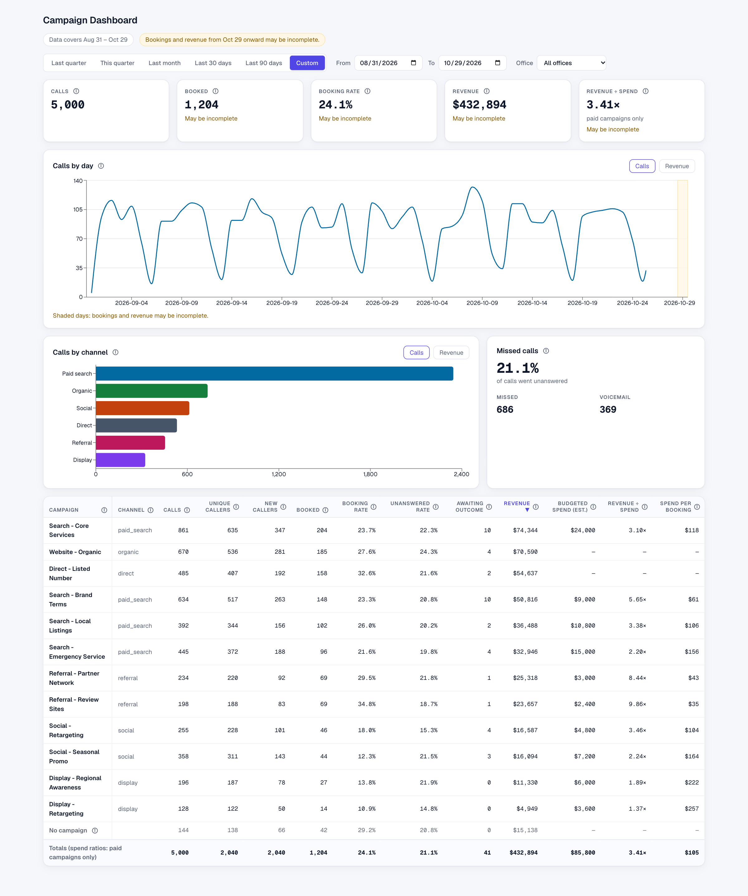
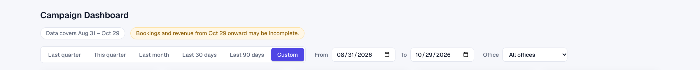
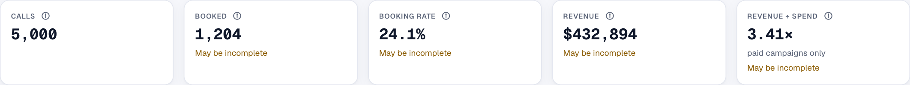
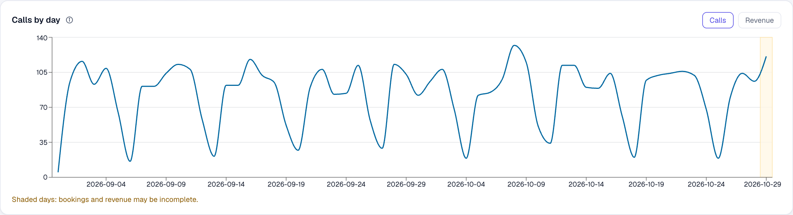
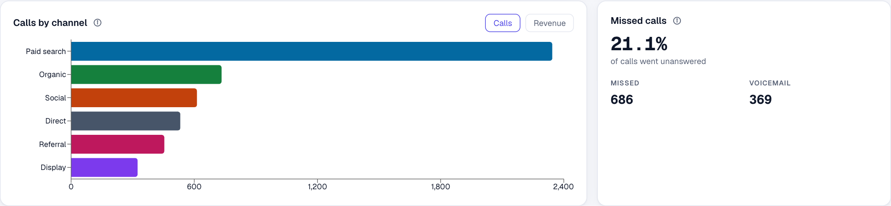
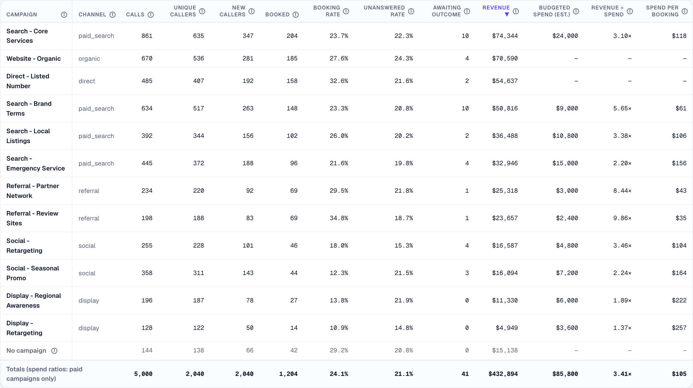
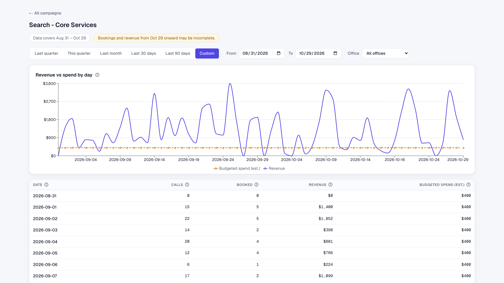
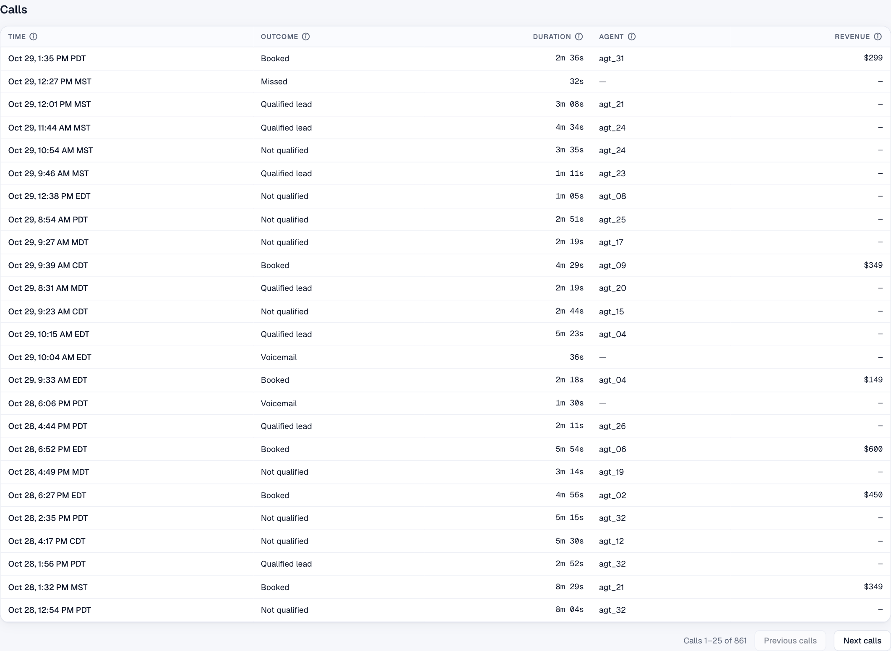
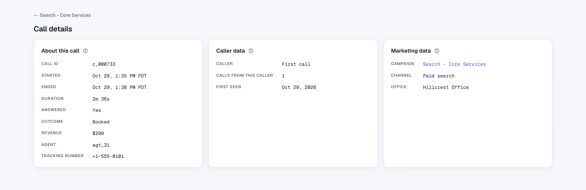

# Call Performance Dashboard

A dashboard that answers: *which campaigns turn calls into revenue, and at what cost?*
The main page shows headline KPIs, two charts, a missed-calls card and a sortable campaign table, all driven by date-range and office filters. Click a campaign to see its daily revenue-vs-spend chart, a day-by-day table and its calls, and click a call to see its details.

- **API:** Ruby on Rails (API-only) in `api/`
- **Web:** Next.js + TypeScript + Recharts in `dashboard-ui/`
- **Database:** PostgreSQL

## Quick start (Docker)

Needs only Docker.

```sh
cp .env.example .env
docker compose up
```

On first start the API creates the database and imports the CSVs from `data/` (later starts skip the import).
Then open:

| Service | URL |
|---|---|
| Dashboard | http://localhost:3000 |
| API | http://localhost:3001/api/meta |
| Database | localhost:5432 (set `DB_PORT` in `.env` if 5432 is taken) |

The default view is "Last quarter", which starts before the data does, so a yellow "Selected range extends outside available data" warning is expected.

## What's in the app

All screenshots use the full data range (Aug 31 to Oct 29, 2026), all offices.



The app has three kinds of page:

| Page | URL | What it does |
|---|---|---|
| Main dashboard | `/` | Account-wide KPIs, charts, missed calls and a campaign table. |
| Campaign detail | `/campaigns/:id` | One campaign's daily revenue vs spend, a day-by-day table and a paged list of its calls. `/campaigns/none` (calls with no campaign) shows only the paged list of calls. |
| Call detail | `/calls/:id` | One call: what happened, who called, and which campaign, channel and office it came through. |

Every page has a light/dark toggle (bottom right). Every metric and column has an (i) info icon with a short definition: hover it, or tap it on a phone.

### Header and filters



- **Date range:** presets (Last quarter, This quarter, Last month, Last 30 days, Last 90 days) or Custom with From / To dates. The default is "Last quarter".
- **Office:** limits every number on the page to one office, or shows all offices.
- **Badges:** "Data covers ..." always shows which dates the data spans. A yellow "Selected range extends outside available data" warning appears when your range goes beyond it. A second yellow warning appears when the range includes days whose outcomes may still be arriving.
- Filters live in the URL, so any view can be shared as a link, and they carry over when you open a campaign.

### The main page, in three groups

#### Group 1: KPI cards



Five cards summarise the selected range and office. They equal the totals row of the table below.

| Card | What it represents |
|---|---|
| Calls | Every call in the range and office, including calls not tied to a campaign. |
| Booked | Calls whose outcome was a booked appointment. |
| Booking rate | Booked ÷ calls. |
| Revenue | Total revenue recorded on calls in the range. |
| Revenue ÷ spend | Revenue from paid campaigns ÷ their estimated spend. Campaigns with no budget and calls with no campaign are left out. Spend is a budget-based estimate (see [Data](#data)). |

Booked, Booking rate, Revenue and Revenue ÷ spend show "May be incomplete" when the range reaches days whose outcomes can still arrive.

#### Group 2: Charts and the missed calls card





| Card | What it represents |
|---|---|
| Calls by day / Revenue by day | A line chart of daily totals across the range, including calls with no campaign. Use the **Calls / Revenue** buttons to switch. Shaded days at the end may still be missing outcomes, which arrive up to about 3 days late. |
| Calls by channel / Revenue by channel | A bar chart of totals per marketing channel (paid search, organic, social, direct, referral, display), largest first. Calls with no campaign are counted under the channel they came in on. Same **Calls / Revenue** switch. |
| Missed calls | The share of calls nobody answered, with the count of **Missed** (rang out) and **Voicemail** (the caller left a message). Missed + voicemail = all unanswered calls. |

#### Group 3: Campaign table



One row per campaign, sorted by revenue (highest first) by default. Click a column header to sort, and click again to reverse. Click a campaign name to open its detail page. On narrow screens the table scrolls sideways with the campaign name pinned.

- The **No campaign** row is always shown below the ranked campaigns, whatever the sort. It is muted, has no spend, and its info icon breaks its calls down by channel.
- The **Totals** row sits at the bottom. Its spend ratios use paid campaigns only.
- A "—" means there is nothing to show (for example, no budget).

| Column | What it represents |
|---|---|
| Campaign | The campaign name. Links to its detail page. |
| Channel | The marketing channel the campaign runs on. |
| Calls | Calls in the date range and office for the campaign. |
| Unique callers | Distinct phone numbers that called. The totals row counts each caller once, even if they called several campaigns. |
| New callers | Calls from a number never seen before. "Never seen" only counts back to the start of the data (Aug 31 office time, Sep 1 UTC), so earlier callers can look new. |
| Booked | Calls whose outcome was a booked appointment. |
| Booking rate | Booked ÷ calls. |
| Unanswered rate | Share of calls not answered (missed or voicemail). |
| Awaiting outcome | Answered calls with no outcome recorded yet. |
| Revenue | Revenue recorded on the campaign's calls in the range. |
| Budgeted spend (est.) | Daily budget × the days in the range that the data covers. Assumes the whole budget was spent, so it can overstate cost. Shows "—" for campaigns with no budget. With an office selected, the column becomes the office's share of the spend, split by its share of the campaign's calls. |
| Revenue ÷ spend | Revenue ÷ estimated spend. Shows "—" when there is no spend. |
| Spend per booking | Estimated spend ÷ bookings. Shows "—" when there is no spend or no bookings. |

### Campaign detail page



Opened from the table (or "No campaign"). It keeps the same filters and has a "← All campaigns" link back. The "No campaign" page has only the Calls list below, with no chart or daily table.

- **Revenue vs spend by day:** this campaign's daily revenue against its estimated daily spend.
- **Daily table:** Date, Calls, Booked, Revenue and Budgeted spend (est.) for each day, 30 days per page, with a totals row for the whole range.
- **Calls:** every call for this campaign in the range, newest first, 25 per page.



| Column | What it represents |
|---|---|
| Time | When the call started, in the office's time zone. |
| Outcome | Booked, qualified lead, not qualified, missed, voicemail, or "Awaiting outcome". |
| Duration | Length of the call. |
| Agent | The agent ID that took the call ("—" if unanswered). |
| Revenue | Revenue recorded on the call. |

### Call detail page



Opened by clicking a call's time in the calls list. Three cards:

| Card | What it shows |
|---|---|
| About this call | Call ID, start and end time (office time zone), duration, whether it was answered, outcome, revenue, agent and tracking number. |
| Caller data | Whether this was the caller's first call, how many calls they have made, and when they were first seen. Phone numbers are never shown. |
| Marketing data | The campaign (linked), channel and office the call came through. |

## Native development

Needs Ruby (version in `api/.ruby-version`), Node and a local PostgreSQL.

```sh
bin/setup   # installs gems and packages, prepares the database, imports the data
bin/dev     # API on :3001 and web on :3000; Ctrl-C stops both
```

## Tests and checks

```sh
# API (RSpec), from api/ (needs a local PostgreSQL; see Native development):
bundle exec rspec
bundle exec rubocop

# Web (Vitest), from dashboard-ui/:
npm test
npm run lint
npx next typegen && npx tsc --noEmit
```

To check the whole Docker stack end to end, run `scripts/smoke.sh` (add `--down` to stop the stack afterwards). It starts the stack, then checks the API and the dashboard; it exits non-zero with a `SMOKE FAIL` message on the first failure.

`scripts/setup-hooks.sh` enables the git hooks (pre-commit runs rubocop and eslint; pre-push blocks pushes to `main`). It runs automatically on `npm install`.

## Data

Source files are in `data/` (`calls.csv`, `campaigns.csv`, `locations.csv`); set `DATA_DIR` to read from elsewhere.
To re-import: `docker compose exec api bin/rails import:all` (or `bin/rails import:all` from `api/`). The import is idempotent.

Things to know about the data:

- It covers 2026-08-31 to 2026-10-29 (office-local dates), about 60 days.
- Calls can be written more than once. The import keeps the latest version by `updated_at`, not the last row in the file, and rejects invalid rows with a reason.
- Outcomes arrive up to about 3 days late, so bookings and revenue near the end of the data can be incomplete (the dashboard shows a badge).
- Some calls have no campaign. They appear as a pinned "No campaign" row.
- The data has no actual ad spend. Spend is estimated from each campaign's daily budget and labelled "Budgeted spend (est.)".

More detail: [plans/PLAN.md](plans/PLAN.md) (the full design), [DECISIONS.md](DECISIONS.md) (product decisions and limits), [TECHNICAL_SUMMARY.md](TECHNICAL_SUMMARY.md) (the 1-2 page technical overview), [TECHNICAL.md](TECHNICAL.md) (architecture, import, metrics, API) and [AI_COST_LOG.md](AI_COST_LOG.md).

## Layout

```
api/           Rails API (specs in api/spec/)
dashboard-ui/  Next.js app
data/          source CSVs
bin/           setup and dev scripts
scripts/       smoke test and git hook setup
docs/          README screenshots
plans/         build plan and per-milestone task breakdowns
```
