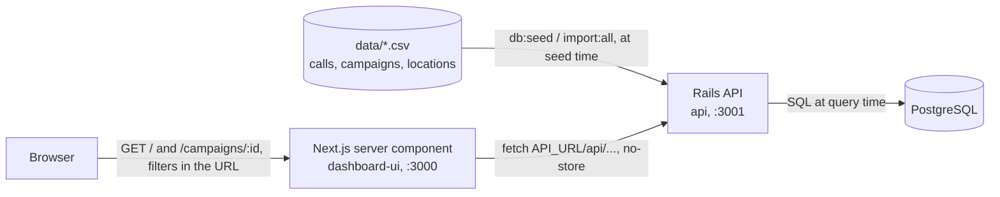

# Technical overview

For engineers working on the code. Running the project is in [README.md](README.md); the full design and rationale is [plans/PLAN.md](plans/PLAN.md), linked below by section instead of repeated.

## Architecture



- The browser only talks to Next.js. Pages are server components that call the API using `API_URL` (`http://api:3001` in Docker, default `http://localhost:3001`). Requests use `cache: "no-store"` and a 5 s timeout (`dashboard-ui/lib/api.ts`). No CORS is involved.
- Filters live in the URL (`preset`, `from`, `to`, `location`), so views are shareable links (`dashboard-ui/lib/filters.ts`, `lib/date-ranges.ts`).
- The API computes every metric in SQL at request time from the `calls` table. There is no rollup or cache.
- The CSVs are seed data. `docker-compose.yml` runs `bin/rails db:prepare db:seed` before starting the API; `api/db/seeds.rb` imports only when `calls` is empty. `./data` is mounted read-only at `/data` (`DATA_DIR=/data`).

## Import pipeline

Design: [PLAN.md section 6](plans/PLAN.md). Code: `api/app/services/importer.rb` and `api/app/services/importer/`.

- `bin/rails import:all` (`api/lib/tasks/`) forces a re-import and prints a summary; it aborts with `import failed: ...` on `Importer::Error`. It is idempotent.
- `Importer::Runner` does everything in one transaction (`requires_new: true`): `ReferenceLoader` (locations, campaigns), `CallsReader` (stream and validate `calls.csv`), `CallsWriter` (stage, upsert, recompute local dates). Any failure rolls back everything, so `calls` is either fully loaded or empty.
- **Versions:** a call can appear several times. The newest `updated_at` (stored as `source_updated_at`) wins regardless of file order; the upsert only overwrites when `excluded.source_updated_at > calls.source_updated_at`. Two rows with the same `(call_id, updated_at)` but different content are both rejected as "conflicting versions"; exact duplicates collapse.
- **Rejected rows:** `Importer::CallRowValidator` rejects a row with a reason and line number instead of failing the import. Rules include blank required fields, unknown channel/outcome, answered/outcome/agent/revenue consistency, `ended_at` before `started_at`, `duration_seconds` not equal to `ended_at - started_at`, and unknown `location_id` / `campaign_id`. The summary lists rejections. If a call's newest version is rejected, it keeps its older valid state.
- **Timezones:** `locations.timezone` is validated against `pg_timezone_names`. `calls.local_date` is the call's `started_at` in the office's timezone, and all date ranges filter on it. After each import, `CallsWriter#recompute_local_dates` fixes any call whose stored date no longer matches its location's timezone.

## Metric definitions

Definitions and rationale: [PLAN.md section 7](plans/PLAN.md). Implementation: `api/app/services/metrics/`.

- `CallFacts` is the single per-call source for every metric. The office filter is a flag (`at_office`), not a WHERE, so campaign-wide call counts (the share denominator) and office counts come from one scan.
- **New callers** use a per-call `NOT EXISTS` probe for an earlier call from the same `caller_number_hash`, ordered by `(started_at, call_id)`, over all calls (ignoring range, office and campaign). It uses the `(caller_number_hash, started_at, call_id)` index, so cost follows calls in range, not total history. "First" means first since the data starts, so earlier callers look new.
- **Spend** is estimated at query time in `SpendSql`, shared by both endpoints. The data has no actual spend: it is `daily_budget_cents` times the days of the range inside data coverage. With a `location_id` it is the office's share of the campaign's calls in range times that, rounded; it is null if the campaign has no calls in range. Daily rows use cumulative rounding so they sum exactly to the table figure. $0-budget campaigns and "No campaign" have null spend.
- **Totals** (`CampaignMetrics`): counts and revenue sum all rows; `unique_callers` is a distinct count, not a sum; rates are recomputed from summed counts; `totals.paid` holds `revenue_per_spend` and `spend_per_booking_cents` over rows with non-null spend only.
- Ratios are `null` when the denominator is null or 0.
- Every campaign is listed even with no calls. The "No campaign" row (`campaign_id: null`) appears only when it has calls, and carries `channel_breakdown`.

## API

Dates are `YYYY-MM-DD`, money is in cents. Routes are in `api/config/routes.rb`; response examples are in [PLAN.md section 8](plans/PLAN.md).

| Endpoint | Params | Returns |
|---|---|---|
| `GET /api/meta` | none | `data_coverage` (`from`, `to`), `freshness` (`latest_update_at`, `outcomes_may_be_incomplete_from`), `locations`, `campaigns`. Coverage and freshness are `null` on an empty database. |
| `GET /api/campaigns/metrics` | `from`, `to` (required), `location_id` (optional) | `range`, `rows`, `totals` |
| `GET /api/campaigns/:id/daily` | `from`, `to` (required), `location_id` (optional) | `campaign`, `days` (one per date in range, zero-filled) |
| `GET /up` | none | Rails health check |

**Validation** (`Api::RangeParams`): `from` and `to` must be present, match `YYYY-MM-DD` and be real calendar dates; `from` must be on or before `to`; the range may not exceed 366 days; a present `location_id` must be a non-blank string. All of these return 400. An unknown `location_id`, or an unknown campaign id on `/daily`, returns 404. The 400 checks run first, so a bad range plus an unknown location is a 400.

**Error shape** (`Api::BaseController`):

```json
{ "error": { "code": "bad_request", "message": "from must be on or before to" } }
```

| Status | `code` | Raised for |
|---|---|---|
| 400 | `bad_request` | `Api::BadRequest` and missing parameters |
| 404 | `not_found` | `ActiveRecord::RecordNotFound`; the message is always `record not found` |

The web client wraps failures in `ApiRequestError` (status, code, message), using `network_error`, `timeout`, `http_error` or `invalid_response` when there is no API error body.

## Data freshness

- Outcomes arrive late, up to about 3 days ([PLAN.md section 3](plans/PLAN.md)). `/api/meta` returns `latest_update_at` (max `calls.source_updated_at`) and `outcomes_may_be_incomplete_from`, the UTC date of `latest_update_at` minus 72 hours (`Api::MetaController::OUTCOME_DELAY`).
- The `awaiting_outcome` metric counts answered calls with no outcome yet.
- `dashboard-ui/lib/badges.ts` and `components/page-header.tsx` drive the header chips:
  - **Coverage chip:** "Data covers ..." from `data_coverage`, or "No data loaded".
  - **Freshness warning:** shown when the selected `to` is on or after `outcomes_may_be_incomplete_from` ("Bookings and revenue from ... onward may be incomplete.").
  - **Partial-range warning:** shown when the range extends outside data coverage.
- Spend is clipped to data coverage, so ranges that start before the data are not charged for days with no calls.

## Testing

Strategy: [PLAN.md section 10](plans/PLAN.md). CI (`.github/workflows/ci.yml`) runs rubocop and RSpec for `api`, and eslint and Vitest for `dashboard-ui`.

- **API (RSpec, `api/spec/`):**
  - `services/importer/` and `import_fixtures_spec.rb`: parsing, row validation and the import against hand-built fixtures.
  - `services/metrics/`: metric formulas, spend and call-facts queries.
  - `requests/`: param validation and the error shape per endpoint.
  - `real_data_spec.rb` and `real_data_consistency_spec.rb` (tag `:real_data`): import the real `data/` CSVs and check that the daily series add up to the table.
  - `lib/scale_check_spec.rb` and `spec/support/spend_oracle.rb`: the scale-check helper and an independent spend oracle.
- **Web (Vitest, `dashboard-ui/`):** unit and component tests next to the code (date presets, badges, table sorting, API client, pages).
- **Commands:** `bundle exec rspec` and `bundle exec rubocop` in `api/`; `npm test`, `npm run lint` and `npx tsc --noEmit` in `dashboard-ui/`.

## Scaling path

Detail: [PLAN.md section 7](plans/PLAN.md) ("First-call query and scaling path").

- Today every request aggregates `calls` directly, backed by indexes on `local_date`, `(campaign_id, local_date)`, `(location_id, local_date)`, `source_updated_at` and `(caller_number_hash, started_at, call_id)` (`api/db/schema.rb`).
- `bin/rails metrics:scale_check` builds about 1M synthetic calls in a scratch `<db>_scale_check` database and runs `EXPLAIN ANALYZE` on the metrics and daily queries (see `api/lib/scale_check.rb` for the env options). It refuses to run against production or a non-scratch database.
- If volume grows, measure first and materialize only when a latency target is missed. The likely next step is a daily rollup table; it would need first-call status stored at write time, with the current query as its backfill and test oracle.
- Spend is computed in one place (`SpendSql`), so replacing the budget estimate with actual spend is a contained change.
