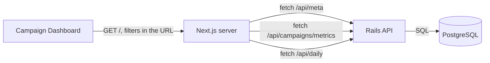
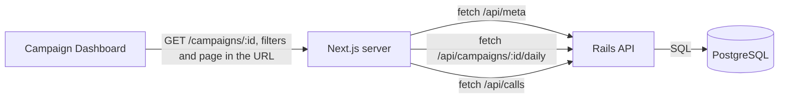
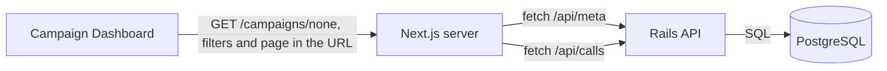
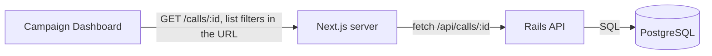
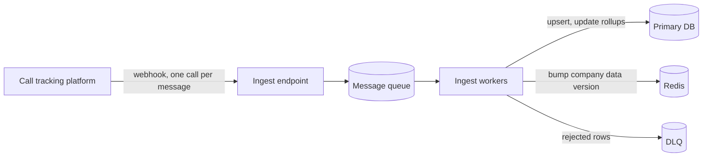
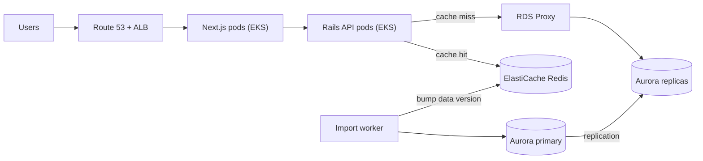

# Technical overview

For engineers working on the code. Running the project is in [README.md](README.md); the full design and rationale is [plans/PLAN.md](plans/PLAN.md), linked below by section instead of repeated.

## Architecture

One diagram per page, showing the API calls Next.js makes to render it.

### Dashboard (`/`)

### Campaign detail (`/campaigns/:id`)

### No campaign (`/campaigns/none`)

### Call details (`/calls/:id`)

- The browser only talks to Next.js. Pages are server components that call the API on the server, in parallel where a page needs several endpoints, using `API_URL`.
- Filters live in the URL (`preset`, `from`, `to`, `location`, plus `page` on call lists), so views are shareable links.
- The API computes every metric and call list in SQL at request time from the `calls` table. There is no rollup or cache.
- The CSVs are seed data, loaded once before the API starts, not read at request time. `docker-compose.yml` runs `bin/rails db:prepare db:seed` before starting the API.

## API

Dates are `YYYY-MM-DD`, money is in cents. Routes are in `api/config/routes.rb`; response examples are in [PLAN.md section 8](plans/PLAN.md). The web client's function for each endpoint is in `dashboard-ui/lib/api.ts`.

| Endpoint | Params | Returns |
|---|---|---|
| `GET /api/meta` | none | `data_coverage` (`from`, `to`), `freshness` (`latest_update_at`, `outcomes_may_be_incomplete_from`), `locations`, `campaigns`. Coverage and freshness are `null` on an empty database. |
| `GET /api/campaigns/metrics` | `from`, `to` (required), `location_id` (optional) | `range`, `rows`, `totals` |
| `GET /api/campaigns/:id/daily` | `from`, `to` (required), `location_id` (optional) | `campaign`, `days` (one per date in range, zero-filled) |
| `GET /api/daily` | `from`, `to` (required), `location_id` (optional) | `range`, `days` (one per date in range, zero-filled), across all calls, including "No campaign", so day sums equal the metrics `totals`. No spend. |
| `GET /api/calls` | `from`, `to` (required); `location_id`, `campaign_id` (a campaign id or `none`), `outcome` (an outcome or `awaiting`), `page` (default 1) (optional) | `page`, `page_size` (25), `total`, `calls` (newest first). Never includes the caller hash. |
| `GET /api/calls/:id` | none | One call: the list row plus `is_first_call`, `caller_call_count` and `caller_first_seen` |
| `GET /up` | none | Rails health check |

## Data freshness

Outcomes arrive late, up to about 3 days ([PLAN.md section 3](plans/PLAN.md)), so recent bookings and revenue can be incomplete.

- **`/api/meta`** returns two freshness fields:
  - `latest_update_at`: the most recent update in the data. The UI does not display it.
  - `outcomes_may_be_incomplete_from`: 3 days before `latest_update_at`. Calls from this date on may still be waiting for their outcome.
- **Where the UI shows it** (when the selected range reaches `outcomes_may_be_incomplete_from`):
  - A freshness warning chip in the page header.
  - Shaded days and a legend in the dashboard overview chart.
  - A "May be incomplete" label on the outcome-based KPI cards.
- **Other header chips** (`dashboard-ui/lib/badges.ts`, `components/page-header.tsx`):
  - Coverage: "Data covers ...", or "No data loaded".
  - Partial range: the range extends outside data coverage.
- **`awaiting_outcome`** counts answered calls with no outcome yet, shown as the "Awaiting outcome" column in the campaign table. It includes outcomes never recorded, not just the recent lag.

## Testing

Strategy: [PLAN.md section 10](plans/PLAN.md). CI (`.github/workflows/ci.yml`) runs RuboCop and RSpec for `api`, and ESLint and Vitest for `dashboard-ui`.

- **API (RSpec, `api/spec/`):**
  - `services/importer/` and `import_fixtures_spec.rb`: parsing, row validation and the import against hand-built fixtures.
  - `services/metrics/`: metric formulas, spend and call-facts queries.
  - `requests/`: param validation and the error shape per endpoint.
  - `real_data_spec.rb` and `real_data_consistency_spec.rb` (tag `:real_data`): import the real `data/` CSVs and check that the daily series add up to the table.
  - `lib/scale_check_spec.rb` and `spec/support/spend_oracle.rb`: the scale-check helper and an independent spend oracle.
- **Web (Vitest, `dashboard-ui/`):** unit and component tests next to the code (date presets, badges, table sorting, API client, pages).
- **Commands:** `bundle exec rspec` and `bundle exec rubocop` in `api/`; `npm test`, `npm run lint` and `npx next typegen && npx tsc --noEmit` in `dashboard-ui/` (`tsc` needs the route types that `next typegen` generates; `next build` and `next dev` also generate them).

## Scaling path

### The workload

- **Read-heavy.** Viewers only read. The only writes are the batch import, so write scaling is a separate, smaller problem.
- **Cacheable.** Responses depend only on the query params and the loaded data, and the data changes only when an import runs.
- **Stale reads are fine.** Outcomes already arrive up to 3 days late ([Data freshness](#data-freshness)), so a replica or cache that is seconds or minutes behind changes nothing the user can see.

### Order of work

1. **Redis cache (ElastiCache).**
   *Caveat: This assumes auth is added, each marketer belongs to a company, and a company id is available for the cache key*. Cache API responses keyed by company, endpoint, params and the company's data version. The API fills the cache itself (cache-aside): on a request it checks Redis, and on a miss it runs the SQL, stores the response under that key with a TTL, and returns it. When the data changes, the version changes, so old entries are never read again and age out. For example: `company_id:/api/campaigns/metrics:from=2026-10-01&to=2026-10-30&location_id=loc_01:v=2026-10-30T14:02:11Z`.
2. **Read replicas.** PostgreSQL with a primary for the import and replicas for all API reads, behind the reader endpoint. This keeps read traffic off the primary, which handles the writes, and lets reads scale on their own by adding replicas. Replica lag is acceptable because outcomes already arrive up to 3 days late.
3. **Rollup tables.** A rollup table stores daily totals that are already added up: one row per campaign, office and day, with the call count, bookings, revenue and so on. Today every request counts raw calls. With a rollup, a request adds up a few hundred small rows instead, so it stays fast as the calls table grows. This helps the aggregate endpoints (the dashboard metrics and daily series, and the campaign daily chart). Call lists and single-call pages still read `calls`, since a rollup has no per-call rows.
4. **Partition `calls` by month.** Partitioning splits one big table into smaller physical tables that Postgres treats as one. Here, `calls` would split into one table per month, based on each call's `local_date`. Queries still go to `calls`, and Postgres sends each one to the right monthly table. Range queries then read only the months they need, and old months can be archived.
5. **Sharding, only if one primary cannot take the writes or the data.**
   *Caveat: This assumes auth is added, each marketer belongs to a company, and the company id is stored on the data*. Sharding splits the data across several primary databases, each holding a subset of companies. Replicas and caches only scale reads, so sharding is the step that also scales writes and total data size beyond what one primary can hold. The natural key is the company, because every query stays inside one company.

### Live call feed

Today the data is a CSV loaded once. Live, calls would arrive continuously from the call-tracking platform. The source system is not chosen yet, so this is the shape the CSV tells us to expect ([PLAN.md section 3](plans/PLAN.md)):

- **One message per write of a call**, with the same fields as a `calls.csv` row. A call usually arrives twice: when it ends, then again about 24 to 72 hours later when its outcome and revenue are filled in.
- **Out of order and duplicated.** Some versions arrive late or twice, so the newest `updated_at` must win, never the last one received. The importer already does this.
- **Reference data** (`campaigns`, `locations`) changes rarely and comes from a separate sync, not the call feed.

- **Publish messages.** The platform sends a webhook for each call update to a small ingest endpoint, which puts the message on a message queue.
- **Consume messages.** Workers ingest messages in small batches instead of one big transaction. Rows that fail go to a dead-letter queue.
- **Bump the data version.** After each batch, the worker sets a new data version in Redis for each company it wrote calls for. The version is part of the cache key, so the API's next request for that company misses the old entries and recomputes from the database. Old entries expire via TTL.

### Deployment on AWS

- **Stateless pods.** Next.js and Rails keep no state, so each runs as an EKS Deployment behind an ALB and scales with a Horizontal Pod Autoscaler on CPU or request rate. The web tier calls the API over the cluster network.
- **Multi-AZ first.** Spread pods and the Aurora instances across availability zones. This covers most availability needs.
- **Multiple regions, if latency or disaster recovery requires it.** Run an EKS cluster per region, route users with Route 53 latency routing, and use an Aurora Global Database with a read replica and a Redis cache in each region. Writes and imports stay in one primary region. Cross-region replication is usually under a second, which is fine for this data. This adds real cost and operational load, so adopt it for a reason, not by default.
- **Static assets** (JS, CSS) go behind CloudFront. Pages stay dynamic and uncached, because they render per request from URL filters.
