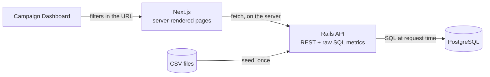

# Technical summary

The short version of the technical deep dive. Detail is in [TECHNICAL.md](TECHNICAL.md) (architecture, API, freshness, failure modes, testing, scaling), [DECISIONS.md](DECISIONS.md) (data model and the alternatives rejected for each choice) and [TRADEOFFS.md](TRADEOFFS.md). Setup is in [README.md](README.md).

## Architecture

- **Rails API + Next.js + PostgreSQL**, run with `docker compose up`.
- The CSVs are **seed data**, imported once before the API starts. The API computes every metric in SQL at request time. There is no cache or rollup.
- Filters (date range, office) live in the URL, so any view is a shareable link.

## Key decisions and rejected alternatives

| Decision | Rejected | Why |
|---|---|---|
| Separate Rails API and Next.js app | Rails full-stack, Next.js only | Typed UI and charts fit Next.js. Rails suits the import and SQL work. |
| PostgreSQL only | SQLite, an analytics store | Good timezone support, and an analytics store is built for scale we don't have. |
| Hand-written SQL for metrics | ActiveRecord | One query gives counts, empty days and totals, with one shared definition of "booked" and "missed". |
| A few purpose-built REST endpoints | GraphQL, math in the browser | Only a handful of fixed views. |
| Filters in the URL, server-rendered pages | Client-side state | Shareable, reproducible links. |

## Data model and flow

- **Three tables:** `locations`, `campaigns`, `calls`. There is no `callers` table, because the caller is a hashed number on each call.
- **Import:** rows are validated, the newest `updated_at` per call wins, and the upsert is idempotent. Re-running changes nothing.
- **Days follow each office's local timezone**, not UTC.
- **Each call counts toward the campaign that took it.** Calls with no campaign get their own "No campaign" row, so totals always add up.
- **Spend is an estimate** (daily budget × covered days), labelled as such everywhere.

## Messy data and freshness

| Problem in the data | How it's handled |
|---|---|
| 5,411 rows for 5,000 calls, some out of order | Newest `updated_at` wins. Exact duplicates collapse. |
| Invalid rows | Rejected with a reason and line number. The rest of the import continues. |
| Conflicting versions (same `updated_at`, different content) | Both rejected. |
| Import fails partway | Full rollback. The database is left as it was. |
| Outcomes arrive 24–72 hours late | A warning chip, shaded chart days and "May be incomplete" on outcome-based KPIs. |
| Ratio with no denominator | The API returns `null` and the UI shows "—". |

## Failure modes and testing

- Bad ranges return 400. Unknown offices or campaigns return 404. A slow API times out after 5 seconds and the page shows an inline error with "Try again".
- **API tests (RSpec):** import and row validation against hand-built fixtures, metric formulas, request validation, and real-data specs that check the daily series add up to the table. An independent spend oracle recomputes spend apart from the production SQL.
- **Web tests (Vitest):** date presets, badges, sorting, API client and pages.
- `scripts/smoke.sh` checks the whole Docker stack. Pre-commit hooks run rubocop and eslint. CI runs those plus both test suites.

## Performance and scaling

The workload is read-heavy, cacheable and tolerant of stale reads, since outcomes already arrive days late. Current data is 5,000 calls, and no cache or rollup is needed at this size (responses take milliseconds). The scaling path, in order:

1. Redis cache keyed by data version (needs auth and a company id for the key).
2. Read replicas.
3. Daily rollup table.
4. Monthly partitions of `calls`.
5. Sharding by company, only if one primary can't take the writes.

A live call feed (ingest endpoint, queue, workers and a dead-letter queue) and an AWS deployment design are in [TECHNICAL.md](TECHNICAL.md).

## Shortcuts and more time

- **Shortcuts:** no caching, rollups or partitioning. The data comes from a CSV import, with no run log. There is no auth or multi-tenancy (out of scope).
- **With more time:** the live feed, the scaling path above, auth and companies, and AI features that call the same data endpoints, so numbers match the table.

## AI tools and cost

- **Claude Code** for planning, implementation, reviews and docs. **Opus 5.5** planned, **Sonnet 5.5** implemented, and **Haiku 5.5** handled small bulk tasks, to keep cost down.
- **Custom skills** (`plan-next-milestone`, `do-next-task`, `pr-review`) start each task from the written plan.
- **Verification:** the tests and hooks above, plus small pull requests that I review before merging. Core views use no model: every number comes from SQL.
- **Spend:** about $60 of the $250 budget (an estimate, off by up to roughly $10). Breakdown in [AI_COST_LOG.md](AI_COST_LOG.md).
