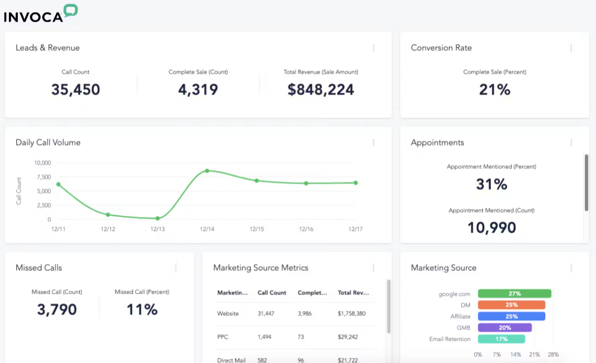
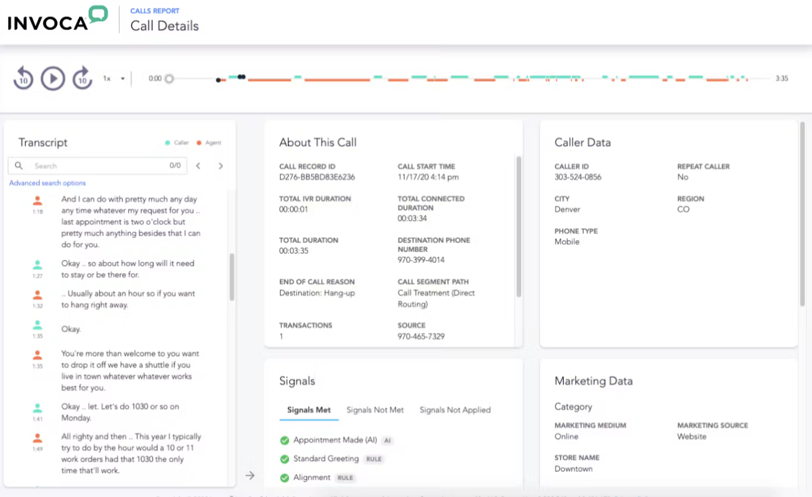
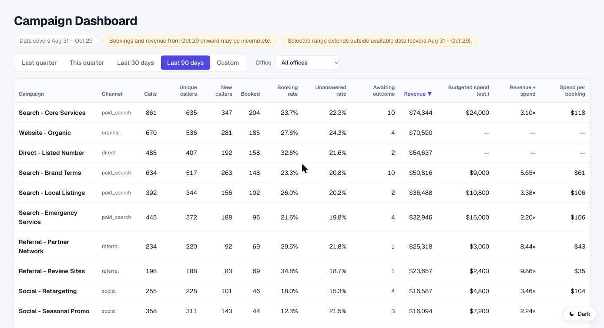
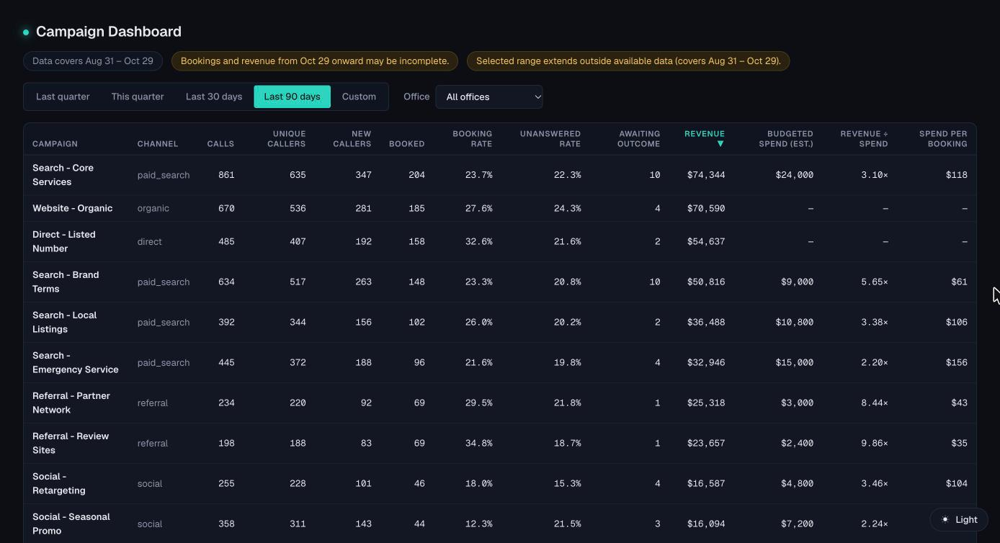

# UI Improvements — Plan

## Status

| Phase | Status | Summary |
|---|---|---|
| U0 — Visual theme (light + dark) | in progress (T1 in review) | "Clarity" light theme (default) and "Midnight" dark mode with a toggle |
| U0b — Daily table pagination | not started | Page the campaign page's daily table (client-side, 30 rows) |
| U1 — Overview KPI cards + daily chart | not started | Invoca-style summary row and an account-wide daily trend |
| U2 — Channel breakdown + missed-calls card | not started | Calls/revenue by channel; missed vs voicemail split |
| U3a — Calls API | not started | `GET /api/calls`, `GET /api/calls/:id` |
| U3b — Calls list | not started | Calls list on the campaign page (and for "No campaign") |
| U3c — Call detail page | not started | About This Call / Caller / Marketing cards |
| Skipped | — | Transcript, audio player, signals, appointments, drag-and-drop widgets (§8) |

Task breakdown (T1–T13) and dependency diagram: [ui-improvements.md](ui-improvements.md).

Statuses: `not started`, `in progress`, `implemented, uncommitted`, `complete`. Update as phases change.

**Sequencing:** U0 and U0b can land any time (U0b after U0, as it uses the theme tokens). U1 onwards starts **after base-plan M5 (docs) is complete** ([../PLAN.md](../PLAN.md) §12), so the docs describe a stable app. Each phase is one PR, branched from `main`.

## 1. Goal

Make the dashboard look and feel like a call-analytics product, using Invoca's dashboard and Call Details screens as layout inspiration, without going beyond what our data supports.

1. **Design:** replace the browser-default UI with a consistent visual system (U0).
2. **Widgets:** add the Invoca-style widgets that map onto our data (U1–U3).

This extends the base plan, which scoped "polished UI" out (§1) and fixed the API at two data endpoints (D6). This plan supersedes both for UI work; see §7 for the base-plan amendments. Auth, multi-tenancy and scale stay out of scope.

## 2. Reference material

All images live next to this file so the plan is self-contained.

**Invoca screenshots (inspiration only — do not copy branding or assets):**

| Screen | File |
|---|---|
| Dashboard (KPI cards, daily call volume, missed calls, marketing source) | [reference/invoca-dashboard.png](reference/invoca-dashboard.png) |
| Call Details (player, transcript, About This Call, Caller Data, Marketing Data, Signals) | [reference/invoca-call-details.png](reference/invoca-call-details.png) |

**Chosen designs (captured from the U0 implementation):**

| | Overview | Campaign detail |
|---|---|---|
| Clarity (light, default) | [clarity-overview.jpg](reference/designs/clarity-overview.jpg) | [clarity-detail.jpg](reference/designs/clarity-detail.jpg) |
| Midnight (dark) | [midnight-overview.jpg](reference/designs/midnight-overview.jpg) | [midnight-detail.jpg](reference/designs/midnight-detail.jpg) |

## 3. What the data can and cannot support

`calls` has: `started_at`, `ended_at`, `duration_seconds`, `caller_number_hash`, `tracking_number`, `campaign_id` (nullable), `marketing_channel`, `location_id`, `local_date`, `answered`, `outcome`, `revenue_cents`, `agent_id` (`api/db/schema.rb`). `campaigns` has a `daily_budget_cents`.

`outcome` values: `booked`, `qualified_lead`, `not_qualified`, `missed`, `voicemail`, **or null** (answered, no outcome recorded — "awaiting outcome", 41 calls; base plan §3). Check constraints guarantee unanswered ⇒ `missed`/`voicemail`, so `missed + voicemail = unanswered` exactly.

Not available: transcripts, recordings, caller city/region/phone type, signals, appointments. Widgets needing these are skipped (§8).

Existing API: `GET /api/meta`, `GET /api/campaigns/metrics`, `GET /api/campaigns/:id/daily`. All metric definitions in base plan §7 (`new_callers`, `booking_rate`, `unanswered_rate`, `awaiting_outcome`, spend, "No campaign", `local_date` bucketing, freshness) **apply unchanged** to every new widget. New endpoints reuse the same SQL building blocks (`api/app/services/metrics/call_facts.rb`, `spend_sql.rb`, `data_coverage.rb`) rather than redefining metrics.

## 4. U0 — Visual theme

**Decision:** "Clarity" is the default; "Midnight" is a user-toggled dark mode. Three options were prototyped (Clarity, Midnight, Ledger); Ledger was dropped. Dark mode does not follow the OS preference — it defaults to light until the user toggles.

### Design tokens

`dashboard-ui/app/styles/theme-light.css` and `theme-dark.css` are the source of truth; this table is a summary so the plan stands alone.

| Token | Clarity (light) | Midnight (dark) |
|---|---|---|
| `--bg` page | `#f6f7fb` | `#0b0e14` |
| `--card` surface | `#ffffff` | `#121722` |
| `--fg` text | `#0f172a` | `#e6e9ef` |
| `--muted` secondary text | `#5b6478` | `#8a93a6` |
| `--border` | `#e3e6ef` | `#212838` |
| `--row-hover` | `#f5f6ff` | `#171e2d` |
| `--accent` (+ `--accent-fg`) | `#4f46e5` indigo (+ white) | `#2dd4bf` teal (+ `#04201c`) |
| `--warn-bg` / `--warn-fg` | `#fff7e6` / `#8a5a00` | `#2a2110` / `#f5c562` |
| `--bad` (errors) | `#c62828` | `#ff6b6b` |
| `--series-revenue` | `#4f46e5` | `#2dd4bf` |
| `--series-spend` | `#f59e0b` | `#fb923c` |
| `--radius` / `--radius-lg` | 8px / 14px | 6px / 10px |
| Shadow | soft two-layer | none (borders only) |
| Body font | Geist Sans 14px | Geist Sans 13px; table numbers in Geist Mono |
| `h1` | 28px / 700 | 20px / 600, with a glowing accent dot |
| Table headers | 12px, sentence case | 11px, uppercase, 0.06em tracking |
| Cell padding (y / x) | 12px / 10px | 8px / 12px |

Shared rules (both themes): segmented control for date presets; data-coverage and freshness notices as pill badges; tables in a rounded card with sticky header, right-aligned tabular numbers, active-sort column in the accent colour, row hover, emphasised totals row; chart in a card; visible focus ring in the accent colour.

### Files (in the working tree, uncommitted)

- `dashboard-ui/app/styles.css` (imports `app/styles/*.css`: `base`, `filters`, `tables`, `chart`, `toggle`, `theme-light`, `theme-dark`) — tokens per theme on `html[data-theme="light|dark"]`, plus element styling for the existing semantic markup (no component changes).
- `dashboard-ui/components/theme-toggle.tsx` — pill button (bottom right) that flips `data-theme` and saves the choice to `localStorage`.
- `dashboard-ui/app/layout.tsx` — loads the CSS, renders the toggle, runs an inline pre-paint script so a saved dark choice causes no white flash, sets the title to "Campaign Dashboard".

### Remaining work

1. Branch from `main` (not from `milestone-5-pr-1-readme`).
2. Leave `dashboard-ui/AGENTS.md` out of the commit. `next dev` edits it on every start, so it will keep showing as modified; revert it with `git checkout` before committing.
3. Style the route loading states (`app/loading.tsx`, `app/campaigns/[id]/loading.tsx`): they render a bare `
` outside `<main>` and are unstyled today.
4. Add `components/theme-toggle.test.tsx`: renders the right label, flips `data-theme`, writes `localStorage`, survives `localStorage` throwing.
5. ~~Rebuild the `web` image and check both themes on :3000.~~ Done 2026-11-22 (the screenshots in §2 are from that build).

**Done when:** both themes render correctly on the overview, detail, loading and error states; the toggle persists across reloads; `npm test`, `npm run lint`, `npx tsc --noEmit` pass.

### Rules for U1–U3 components

- Use theme tokens only; no hard-coded colours. Verify every new component in both themes.
- **Tailwind-first, everywhere (decision).** All styling uses Tailwind utilities in `className`, with theme tokens exposed through `@theme` in `globals.css` (e.g. `bg-card`, `text-muted`, `border-border`, `text-accent`) so utilities follow `data-theme`. No CSS Modules, no new bare-element or global component rules. `app/styles/*.css` is the **legacy** bare-element styling (e.g. `main > p:not([role])`, `main > table`, `figure`); task T1b migrates the existing components to Tailwind and deletes those files except the token files. Until T1b lands, new widgets must not inherit those rules by accident (don't use bare `
`/`<table>` children of `<main>`).
- New tokens are added to `app/styles/theme-light.css` and `theme-dark.css` in the phase that needs them, and mapped in `@theme` (U1: `--series-calls`; U2: a six-colour `--channel-*` palette that passes contrast in both themes).

## 4b. U0b — Daily table pagination

**Problem:** the campaign page's daily table (`components/daily-table.tsx`) renders one row per day in the range: ~90 rows for "Last 90 days", up to 366 for a custom range (the API caps ranges at `MAX_DAYS = 366`, `api/app/controllers/api/range_params.rb`). Most of those rows are `$0` days outside data coverage, and the table pushes everything else far down the page.

**Not paginated: the overview campaign table.** It always has 12 campaigns + the "No campaign" row. Paging it would split the client-side sort across pages, hide rows that must stay visible so columns visibly sum to the totals row, and move the pinned "No campaign" row (base plan D12) to the last page. Revisit with server-side paging and sorting only if campaign count grows into the hundreds. The calls list (U3) has its own server-side pagination.

**Approach: client-side pagination, no API change.** The page already fetches every day for the chart, so the table slices the same `days` array.

- **Page size 30**, sorted oldest first (matches the chart's x-axis).
- **Pager:** Previous / Next buttons and a "Days 31–60 of 90" label, below the table. Hidden when the range fits on one page (≤ 30 days). Buttons disabled at the ends, not removed.
- **Totals row** stays on every page and always covers the **whole range** (computed from all days, as today via `sumDays`), so it keeps matching the chart. Label it "Totals (all N days)" so it isn't read as a page total.
- **State:** page number in component state, not the URL. It resets to page 1 when the date range or office changes (key the table on `from|to|location`).
- **Accessibility:** pager is a `<nav aria-label="Daily table pages">`; the range label is `aria-live="polite"` so page changes are announced; buttons have explicit labels ("Previous 30 days" / "Next 30 days").
- **Styling:** Tailwind utilities using theme tokens, per §4 rules; checked in both themes.

**Alternative considered:** a fixed-height scroll box with a sticky header. Simpler, but scanning up to 366 rows is still painful; rejected.

**Files:** `components/daily-table.tsx` (slice + pager), optionally a small reusable `components/pager.tsx` that U3b's calls list can reuse (that one is server-paged, so the component takes `page`, `pageCount`, `onChange` and stays agnostic about where data comes from).

**Tests** (`components/daily-table.test.tsx`):
- 90 days → 3 pages; page 1 shows days 1–30, page 3 shows 61–90.
- ≤ 30 days → no pager.
- Uneven last page (e.g. 45 days → 30 + 15).
- Previous disabled on page 1, Next disabled on the last page.
- Totals row identical on every page and equal to the sum of all days.
- Changing the range resets to page 1.

**Done when:** a 90-day and a 366-day range page correctly; totals match the chart on every page; filters reset paging; `npm test`, `npm run lint`, `npx tsc --noEmit` pass; both themes checked.

## 5. Widget mapping

### Screenshot 1 — dashboard ([reference/invoca-dashboard.png](reference/invoca-dashboard.png))

| Invoca widget | Relevant? | Our version | Phase |
|---|---|---|---|
| Leads & Revenue (call count, sales, revenue) | Yes | KPI cards: Calls, Booked, Revenue | U1 |
| Conversion Rate | Yes | KPI cards: Booking rate; Revenue ÷ spend (paid only) | U1 |
| Daily Call Volume | Yes | Account-wide daily chart on the overview | U1 |
| Missed Calls (count and %) | Yes | Card: missed, voicemail, unanswered rate | U2 |
| Marketing Source (bar chart) | Yes | Calls / revenue by channel, horizontal bars | U2 |
| Marketing Source Metrics (table) | Already have | The campaign table | — |
| Appointments | No | No appointment data; "Booked" covers it | Skipped |
| Per-widget ⋮ menus, drag-and-drop layout | No | Fixed card grid | Skipped |

### Screenshot 2 — Call Details ([reference/invoca-call-details.png](reference/invoca-call-details.png))

| Invoca widget | Relevant? | Our version | Phase |
|---|---|---|---|
| About This Call | Yes | Call ID, start/end time (office-local + timezone), duration, answered, outcome (incl. "Awaiting outcome"), revenue, agent, tracking number | U3c |
| Caller Data | Partly | First call vs repeat caller, caller's call count, first-seen date. **Never the caller hash** (§6 U3a). No city/region/phone type | U3c |
| Marketing Data | Yes | Campaign (link, or plain "No campaign"), channel, office | U3c |
| Transcript, audio player, timeline | No | No audio or text data; no AI in v1 | Skipped |
| Signals | No | No signal data; `outcome` is the closest field | Skipped |

## 6. Phases

### U1 — Overview KPI cards + daily chart

**Goal:** the overview leads with the answer: a KPI row and a trend line above the campaign table.

**Decisions to settle first (§9):** chart metric (calls only vs calls + revenue). Proposal: calls as the line, revenue as a toggle; the endpoint returns both either way.

**Backend — `GET /api/daily?from=&to=&location_id=`**
- Response: `{ range, days: [{ date, calls, booked, revenue_cents }] }`. Every day in range is present (zero-filled), bucketed by `local_date`.
- **Includes "No campaign" calls**, so day sums equal `/api/campaigns/metrics` `totals` for the same filters. **No spend** in v1 of this endpoint (account-level spend would need the D11 allocation for every campaign; add later if wanted, via `SpendSql`).
- Implementation: today's zero-fill lives inside the campaign-scoped CTE in `campaign_daily.rb` (lines 28–52) mixed with spend. Extract the date-series + `CallFacts` aggregation into a shared helper used by both, rather than copy it.
- Params and errors as base plan §8: invalid range → 400; unknown `location_id` → 404 (same as metrics).
- Specs: zero-fill across empty days; office filter; "No campaign" included; day sums = metrics totals; invalid range; unknown location.

**Frontend**
- `components/kpi-cards.tsx` — Calls, Booked, Booking rate, Revenue, Revenue ÷ spend ("paid campaigns only"). Data from `totals` / `totals.paid` already returned by `/api/campaigns/metrics`; no new request. Null → "—" via `lib/format.ts`.
- `components/overview-chart.tsx` — follows `daily-chart.tsx` patterns (`role="img"`, caption, screen-reader summary, theme series colours).
- `lib/api.ts`: `getAccountDaily()`; `lib/api-types.ts`: `AccountDailyResponse` (`DailyResponse` is already the campaign type).
- `app/page.tsx` order: header → filters → KPI row → chart → table. Both blocks respect date and office filters; empty range shows the existing "No calls in this range" message instead.
- **Freshness:** when the range reaches `meta.freshness.outcomes_may_be_incomplete_from`, the Booked/Revenue/Booking-rate cards show a "may be incomplete" marker, and the chart marks the affected days (shaded band or note).

**Tests:** component tests (values, nulls, empty, freshness marker); request specs above.

**Done when:** KPI values equal the table's totals row; chart day sums equal the KPI totals; both change with filters; freshness marker appears for ranges reaching the last ~3 days; both themes checked.

### U2 — Channel breakdown + missed-calls card

**Decision:** extend existing responses additively; **no new endpoint**.
- Add `missed` and `voicemail` counts to `totals` in `/api/campaigns/metrics` (additive fields; existing clients unaffected). Update base plan §8 and `Totals` in `lib/api-types.ts`.
- Channel chart is computed **client-side**: campaign rows already carry `channel`; extend the "No campaign" row's `channel_breakdown` (`campaign_counts.rb`) with `booked` and `revenue_cents` so unattributed calls can be split by channel too.

**Frontend**
- `components/channel-chart.tsx` — horizontal bars by channel, metric switch (calls / revenue; default calls). Uses the `--channel-*` tokens added in this phase.
- `components/missed-calls-card.tsx` — missed, voicemail, unanswered rate (missed + voicemail = unanswered; spec asserts this).

**Tests:** spec for new totals fields and extended `channel_breakdown`; unit test for client-side channel aggregation (channel sums = totals).

**Done when:** channel bars sum to the totals row; the missed-calls card agrees with `unanswered_rate`; both themes checked.

### U3a — Calls API

**`GET /api/calls?from=&to=&location_id=&campaign_id=&outcome=&page=`**
- `campaign_id`: a campaign id, or `none` for unattributed calls. `outcome`: one of the five values or `awaiting`; any other value → 400.
- Pagination: offset-based, `page` (1-based), fixed page size 25, max page 1–N; response includes `total`. Out-of-range page → empty `calls` with correct `total`. Sort: `started_at DESC, call_id DESC` (stable).
- Row fields: `call_id`, `started_at`, `ended_at`, `local_date`, `timezone`, `duration_seconds`, `answered`, `outcome` (null = awaiting), `revenue_cents`, `agent_id`, `tracking_number`, `campaign: { id, name } | null`, `channel`, `location: { id, name }`.

**`GET /api/calls/:id`** — the row fields plus caller facts: `is_first_call`, `caller_call_count`, `caller_first_seen` (date). Unknown id → 404.

**Privacy:** `caller_number_hash` is **never returned**. The hashes are short (8 hex chars, e.g. `h_5c7a0d2b`) and could be brute-forced against the phone-number space. Only derived facts are exposed.

**Repeat-caller rule:** `is_first_call` uses **exactly** the base-plan `new_callers` definition (§7, D2): no earlier call by the same caller, ordered by `(started_at, call_id)`, across all calls, ignoring every filter. Extract that `NOT EXISTS` probe from `call_facts.rb` (lines 32–36) into one shared SQL fragment used by both. "Repeat caller" in the UI = `NOT is_first_call`.

**Specs:** each filter; `campaign_id=none`; `outcome=awaiting`; invalid outcome → 400; pagination edges and stable order (incl. a `started_at` tie); 404; `is_first_call` matches the metrics `new_callers` count over the same calls; response never contains a `caller_number_hash` key.

### U3b — Calls list

- Campaign detail page: a "Calls" section under the daily chart/table — time (office-local), outcome (incl. "Awaiting outcome"), duration, agent, revenue; paged (25), reusing the `Pager` component from U0b.
- "No campaign" row on the overview links to a calls list for `campaign_id=none` (new route, e.g. `/campaigns/none`, — settled: a calls-only page at `/campaigns/none` with no chart or table).
- `page` joins the URL state: add it to `buildQuery` (`lib/filters.ts`); changing date or office **resets** `page` to 1.

**Done when:** list is filtered by the page's date/office; paging works; filter changes reset paging; empty state shown.

### U3c — Call detail page

- New route `app/calls/[id]/page.tsx` with three cards: About This Call, Caller Data, Marketing Data (mapping in §5).
- Times shown in the call's office timezone with the zone abbreviation (one campaign spans offices in five timezones).
- **Back link:** `BackLink` only returns to the overview (`overviewHref`). Add a variant that returns to the source list — a new `listHref(campaignId | "none", query)` (`detailHref` already exists for the campaign page) with the same filters **and page**, or the "No campaign" list. Plain text, not a link, when the call has no campaign in Marketing Data.

**Tests:** each card (incl. null outcome, null revenue, no campaign, first vs repeat caller); not-found page; back link preserves filters and page.

**Done when:** every list row opens a detail page; back returns to the same list position; no caller hash appears anywhere in the UI or network responses.

## 7. Base-plan amendments (done in task T13, after the API tasks land)

In [../PLAN.md](../PLAN.md):
- §1: note that "polished UI" is now covered by this plan.
- D6: amend "two data endpoints" to point here for the additional ones.
- §8: document `/api/daily`, the new totals fields, the extended `channel_breakdown`, and `/api/calls*` once they have all landed (see [ui-improvements.md](ui-improvements.md), T13).
- Status table: link this plan (done).

## 8. Out of scope

- Transcript, audio player, call timeline (no data; needs a new source and AI).
- Signals and appointments (no data).
- Caller city, region, phone type (not in the CSV).
- Exposing raw caller hashes or phone numbers.
- Drag-and-drop or user-configurable layouts, per-widget menus.
- Invoca branding, logos or assets.

## 9. Open questions

Settle before the phase that needs them:

| # | Question | Needed by | Proposal |
|---|---|---|---|
| 1 | Overview chart: calls only, or calls + revenue? | U1 | Calls line with a revenue toggle; endpoint returns both |
| 2 | Channel chart default metric | U2 | Calls (as Invoca), with a revenue switch |
| 3 | Calls list page size and sort | U3a | 25, newest first |
| 4 | Route for the "No campaign" calls list | U3b | Settled: `/campaigns/none`, calls-only (no chart/table) |
| 5 | Should dark mode follow the OS preference on first visit? | Any time | No — default light (current behaviour) |

Settled: caller hash is never exposed (U3a); U2 extends existing responses instead of adding an endpoint.
